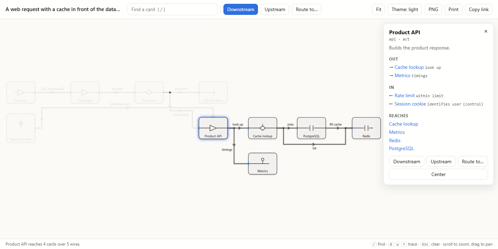
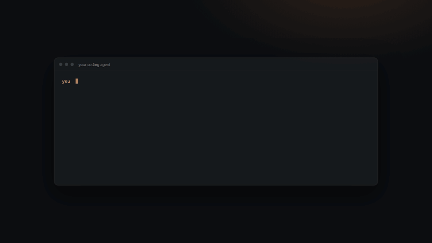
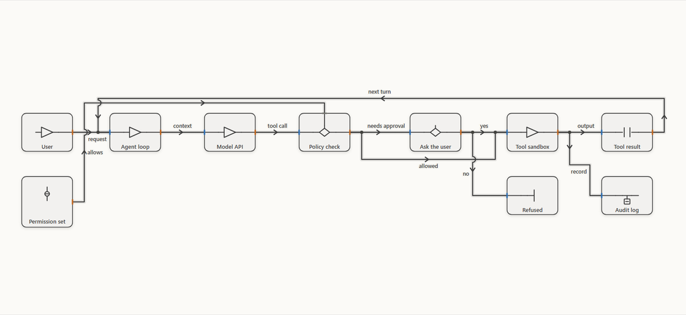
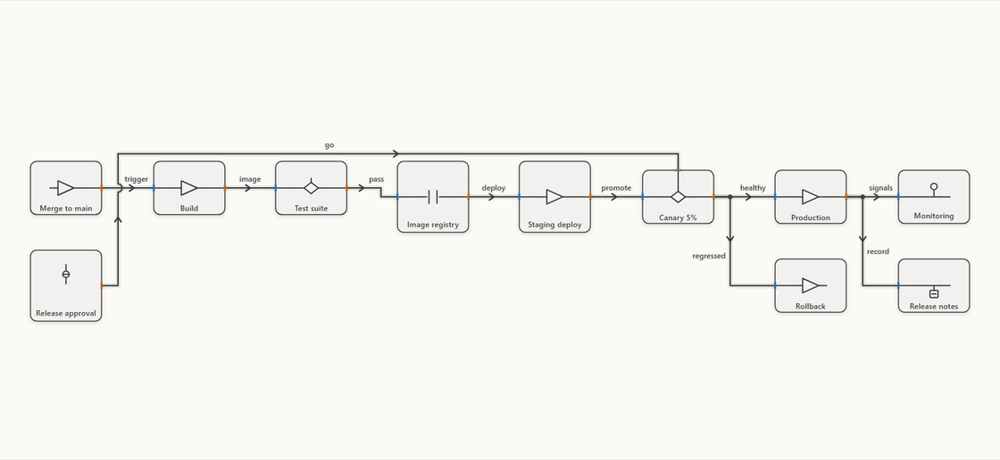
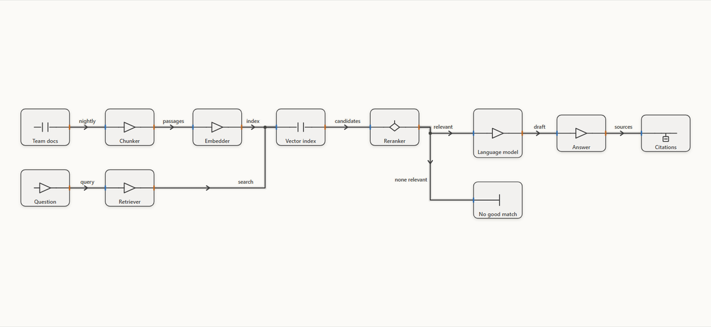
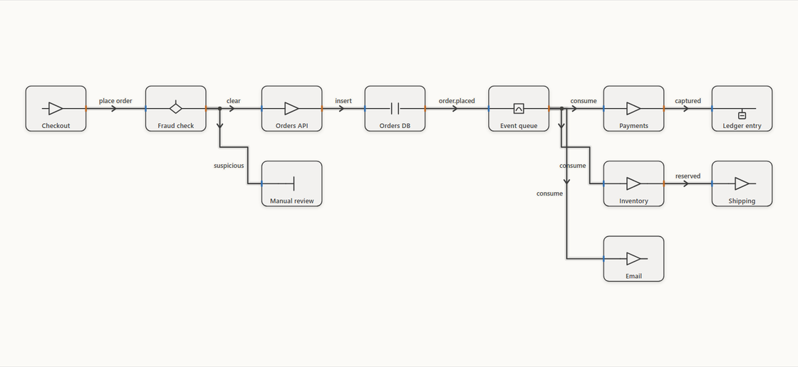
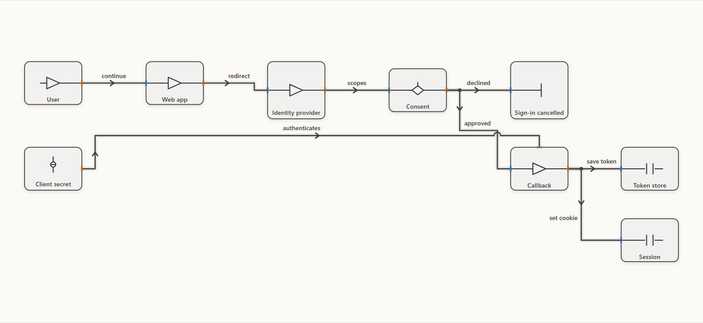
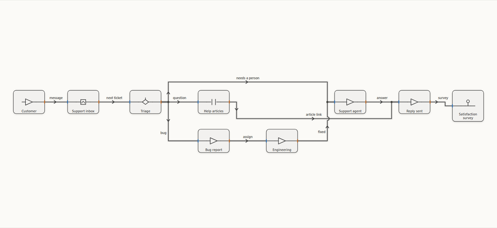

<h1 align="center">Schematically</h1>
<h3 align="center">Describe a system. Get an interactive diagram.</h3>

<p align="center">
  <picture>
    <source media="(prefers-color-scheme: dark)" srcset="docs/assets/readme-hero.dark.png">
    
  </picture>
</p>

<p align="center">One sentence to your coding agent becomes one HTML file you can search, trace and share.<br>It opens from disk, offline, in any browser. Works with Claude Code, Codex, Cursor and OpenCode; needs Node 18 or newer.</p>

<p align="center">
  <a href="#start-here"><strong>Get started</strong></a> ·
  <a href="#gallery"><strong>Gallery</strong></a> ·
  <a href="#see-it-in-35-seconds"><strong>35-second walkthrough</strong></a> ·
  <a href="site/"><strong>The site's source</strong></a>
</p>

## Start here

```bash
npx skills add bdf1992/schematically --skill schematically
```

Then tell your agent, for example:

```text
Use Schematically to diagram a web request: Browser calls the API, the API checks Redis,
and a cache miss queries PostgreSQL and fills the cache.
```

The agent writes a `.sov` document and runs `node bin/schematically.mjs deliver file.sov --open`, which checks it against the model below, lays it out, and writes one `.html` file that works offline: search, downstream and upstream tracing, routes between cards, light and dark, PNG and print, and links that restore a view. Keep going in chat ("add authentication", "put the database in a private network"); a failed run keeps the last good file. Without an agent, `node bin/schematically.mjs demo --open` from a checkout writes and opens an example.

| Agent | Install for every project | Skill folder |
| --- | --- | --- |
| Claude Code | `npx skills add bdf1992/schematically --skill schematically --agent claude-code -g -y` | `~/.claude/skills/schematically` |
| Codex | `npx skills add bdf1992/schematically --skill schematically --agent codex -g -y` | `~/.agents/skills/schematically` |
| Cursor | `npx skills add bdf1992/schematically --skill schematically --agent cursor -g -y` | `~/.agents/skills/schematically` |
| OpenCode | `npx skills add bdf1992/schematically --skill schematically --agent opencode -g -y` | `~/.agents/skills/schematically` |

Leave out `-g` to install into the current project instead. Each agent has a getting-started page in the site (`site/build.mjs` writes `start/<agent>.html`).

The same `.sov` opens in the full editor (`index.html`) for direct editing and simulation.

## See it in 35 seconds

<p align="center"></p>

## Gallery

Every example below was delivered by `bin/schematically.mjs deliver` from the `.sov` beside it. Each `.sov` is what an agent writes from the sentence in [`site/gallery.json`](site/gallery.json); `node site/build.mjs` delivers them all into the site.

| | |
| --- | --- |
| <br>**An agent calls a tool under a policy** · [`agent-tool-call.sov`](site/gallery/agent-tool-call.sov) | <br>**A release from merge to production** · [`release-pipeline.sov`](site/gallery/release-pipeline.sov) |
| <br>**Answering from your own documents** · [`rag-answer.sov`](site/gallery/rag-answer.sov) | <br>**An order fans out through an event queue** · [`order-events.sov`](site/gallery/order-events.sov) |
| <br>**Signing in with a third-party account** · [`sign-in.sov`](site/gallery/sign-in.sov) | <br>**A support ticket, inbox to resolution** · [`support-ticket.sov`](site/gallery/support-ticket.sov) |

## What it is underneath

SOV Schematic is a compact, AI-native schematic editor. A document is a semantic model — Components, Parts, Wires, Form, boundaries, signals, containment — projected to SVG, not a drawing that pretends to be one. People edit it in the browser; agents edit it through the same data core over a Browser API, HTTP, and MCP. The skill above is the shortest path into it.

## The model

- **Point / Path / Plane** — the dimensional basis, and the first three entries in the palette. A 0D Point is an attachment. A 1D Path carries between its two ends. A 2D Plane bounds a region that hosts Points on its boundary and Components in its interior. Each has a minimal default record; the preset lives in `05-data-core.js`.
- **Hosting is attachment** — drop a Point on a Path, on a Plane boundary, or on a Wire and it sticks there parametrically (`placement = {kind: path | edge | wire, t}`), riding along when the host moves or resizes. Drop it inside an open Plane and it is hosted in the interior. A Point on a boundary with face `both` is a crossing.
- **Component** — a typed Plane: a closed boundary with behavior, content, and a Form. Nested Components use the same implementation as root Components.
- **Form** — dimension + Body + Frame + addressable Regions. Dimensions are earned: 0D behaves as an attachable point, 1D as a path/carrier with endpoint topology, 2D as a surface/boundary with addressable boundary attachment points.
- **Attachment points (0D)** — one concern normalizes Port-like behavior everywhere: selection, hit-testing, wiring, color, label, history, and API behavior are identical whether a point lives on a 1D path or a 2D boundary. Built-in boundary points are template data (`config.attachmentDefaults`): typed Components start with left/right/top, a Plane starts with none.
- **Wire = carrier Path** — every Wire is a 1D Form with the carrier role, and each of its two ends is either bound to an attachment point or free in space. Drawing from a port binds both ends; the palette Path drops a carrier with two free ends; an end handle binds when dropped on a Point and frees when dropped elsewhere. Both ends bound and sharing an exposed surface is a connection. Wires can host Components inline (`wireId + t`); duplex Wires carry simultaneous forward/reverse packets.
- **Direction ≠ access ≠ authority** — Ports carry direction (Input / Output / Input + Output / Trigger) and access (None / Read / Write / Read + Write) as independent axes. Read/Write describes the represented effect; it never grants permission.
- **Boundaries are real** — no implicit reach-through. Crossing a Component boundary requires an inside-facing or both-facing Port on that Component, and every surface (UI, API, HTTP, MCP) enforces the same legality.

`ATTACHMENT-POINT-MODEL.md`, `FORM-MODEL.md` (and the proposed `SECTION-MODEL.md`, `GRAPH-MODEL.md`, `LAYOUT-MODEL.md`), `HOST-SURFACE-MODEL.md`, `CANVAS-MODEL.md`, and `reference/REFERENCE.md` specify these in detail.

## The editor

Semantic undo/redo with gesture compression; named checkpoints persisted in the file; multi-select, marquee, and a semantic clipboard for Component subtrees with their internal Wires; Pin (geometry frozen), Lock (mutation frozen), Hidden (recoverable), Opacity, and per-entity Rate; settle/ghost hosting onto open interiors and Wires with an intentional dwell so growth never creates surprise objects; blank-canvas quick search; light/dark/system appearance with surface-relative ink; a global time scale composed with per-Component and per-Wire rates for packet travel. `EDITOR-KERNEL.md` covers the kernel contract.

## Files and formats

One desktop-style **File** menu: New, Open, Save, Save As, Export SVG, Export Package, Restore Recovery. Editable documents are `.sov`; portable packages are `.sovpak`; browser recovery is deliberately separate from file save. Export SVG writes the picture, not the screen: labels are drawn at their base size times the document scale whatever the camera zoom, so the same document exports the same file zoomed in or out. Where the File System Access API exists, Save writes back to the file handle; otherwise it falls back to a download.

- `.sov` → `soveraeign.schematic/document@0.1`
- `.sovpak` → `soveraeign.schematic/package@0.1`
- recovery → `soveraeign.schematic/workspace@0.1`
- CRUD envelopes → `operation@0.1` / `receipt@0.1`

Saved documents carry authored truth only. Runtime projections (local canvas descriptors, boundary/parts, port-level mirrors, realized colors) are rebuilt on load and never written, so a `.sov` is a few lines per entity. Older files that still carry those projections load unchanged.

Schemas live in `formats/`; `DATA-FORMATS.md` explains them.

`python scripts/export_svg.py [file.sov ...] [--out DIR] [--appearance light|dark] [--loop]` renders documents to standalone `.svg` files headlessly (defaults to every example). Computed styles are inlined, so the files render outside the editor, for example as images in markdown. Packet travel times come from path length and rate, so an export animates without ever repeating; `--loop` snaps every animation to a divisor of one period so the file returns to where it began, moving no travel time further than a stated budget. `python scripts/loop_svg.py file.svg --record file.gif` writes one loop as a GIF, animated WebP, or APNG, stepping the SVG clock rather than sleeping between frames. `tests/svg_export_qa.py` keeps the examples exporting and `tests/loop_svg_qa.py` checks that a looped export is actually back at its start after its period. `node scripts/validate_sov.mjs file.sov` validates documents headlessly with the same data core.

`python scripts/export_html.py [file.sov ...] [--out DIR] [--open]` delivers each document as one interactive `.html` file that opens from disk with nothing installed: the picture in light and dark, search, a card's details, what it reaches downstream and what reaches it upstream, the shortest route between two cards, zoom and pan, PNG and print, and a link (the URL fragment) that restores any of those views. Tracing reads the graph core's own arcs, and `tests/html_viewer_qa.py` checks it against `reach` and `paths` for every card of every example.

## Agent surfaces

`window.SovSchematicAPI` (browser), a REST surface, and an MCP server (`mcp/server.mjs`) all delegate to the same transport-neutral data core — agent-created records cannot bypass editor legality, refusals return receipts without entering history, and history/checkpoints are operable over MCP. See `API.md` and `MCP.md`.

The agent-facing corpus ships with the repository:

- `AGENTS.md` — repository invariants and concern contract
- `skills/author`, `skills/author-offline`, `skills/operator`, `skills/reviewer` — authoring (live and file-only), operating, and reviewing skills
- `examples/` — executable golden documents and a portable reference pack

## Source and build

`index.source.html` + `src/*.js` + `styles/app.css` are the canonical development inputs. `python build.py` produces `index.html`, a deterministic standalone build that opens directly from disk. Module ownership is defined in `MODULES.md`; do not duplicate a concern into another module.

## Desktop

`desktop/` is a Tauri crate that wraps the same `index.html` in a native window. `cargo build --manifest-path desktop/src-tauri/Cargo.toml` (or `tauri build` from `desktop/src-tauri`, for a real installer) builds it. The Windows installer registers `.sov` and `.sovpak`, so double-clicking a document opens it in SOV Schematic.

## Quality practice

`python scripts/qa.py` is the single authoritative gate, identical locally and in CI: static checks, browser interaction suites, API/HTTP/MCP parity and conformance, stress and performance watchers, mutation tests, the golden corpus, and syntax checks. Defects found by hand get an issue and, once fixed, a regression suite inside the gate. Pushes to `main` deploy to GitHub Pages only after the gate passes. `LOCAL-SETUP.md` covers machine setup, the local QA loop, and the green-main update pattern; `docs/BRANCHING.md` covers the release flow.

## Code graphs

```
python scripts/graph_to_sov.py GRAPH --out FILE [--labels FILE] [--label-length N] [--no-layout]
```

`GRAPH` is a graphify-format `graph.json`, written by graphify or by system-cartographer. The output is a laid-out document with one card per function, class and module, one wire per call or reference marked `EXTRACTED` or `INFERRED` in `config.basis`, and one group per community. From a graphify graph it reads each node's callable flags and `community`; from a system-cartographer graph it reads `kind` and `code_community`. `--labels` is a JSON object from community number to group label; `--no-layout` writes the document without coordinates. The command prints its counts as one line of JSON.

`--level communities` writes FILE with one card per community and one wire per community pair labelled with its edge count, plus `FILE-stem.communities/community-N.sov`, a document of each community's functions that the card's `config.documentRef` names.

## Direction

The current line stabilizes primitives so future work adds definitions and rules rather than parallel implementations. The concerns ahead, tracked as NEXT issues and sketched in `ROADMAP.md`, `HORIZON-SPACE.md`, and `docs/vision/`:

- a formal Point / Path / Surface cell grammar, with the public Wire concept subsumed into generic 1D Path semantics (primitives, hosted-Point attachment, template attachment defaults, and Wire as a carrier Path with bound-or-free ends have landed; what remains is storing carriers and Components in one record kind, which is a file-format transition);
- data-driven attachment descriptors, domain packs, and data-backed built-ins;
- a small logic machine for particle routing and signal state;
- generalized Spaces — admitted grammars beyond the current 2D canvas, including eventual 3D volume semantics;
- prompt/instruction compilation and richer agent authoring.

Historical acceptance records (`BETA-0.1.md`, `QA-0.1.md`, `RC-0.1.md`, `RC-FINISH-LINE.md`, `PUBLIC-BETA-FREEZE.md`, `MODULE-QA.md`, `contrast-audit.md`) document how past lines were tested and remain as records rather than living documentation.

## Kore design context

[Kore schematic context](docs/kore/README.md) holds the signed coordinates,
Knode/Kord/Korner/Kradle design, original package, tileable diagrams and portable
model checks for cloud sessions. It distinguishes available code from proposed
runtime behavior and historical cloud work that has not been recovered.
