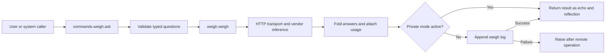

# Kore ARCH refactor specification

Design snapshot consolidated 2026-10-10, America/Chicago; promoted into repository documentation for cloud sessions. Serves the existing workstation kernel remodel, mission `workstation-the-kernel-centre-is-rebuilt-in-place`, case `ep-kernel-drift-map`.

Kore is the construction and expression system for remodeling the workstation and its generative inference programs. The refactor must connect its terms and diagrams to actual code, state owners, calls, tool surfaces, authority and observed outcomes. This draft brings the supplied references and local ARCH work together; unresolved meanings remain unresolved. Runtime refactoring begins after the relevant slice of the specification is understood.

## 1. Starting position

The workstation already has a remodel program, a cradle engine specification, architectural rules, a checklist and reviewed cuts. Continue that program rather than create a competing kernel. The cradle supplies engine requirements; Kore supplies the expression under study. Their relationship is a proposed mapping, not an established identity.

The new vocabulary image contains two separate lists, as Bdo clarified on 2026-10-10:

- System concerns: User, Inference, Register, Interface, State.
- Kore terms: Kore, Knode, Kord, Korner, Kernal.

There is no row-by-row equivalence between the lists. Keep `Kernal` as supplied until its meaning and spelling are settled. In particular, Register is not automatically a Kord, and State is not automatically Kernal.

The imported handoff records the latest correction: reflection and echo are the same result; drive comes from the system; tools and services extend what agents and users can achieve within time and budget. It also preserves shared identity/state with local views, explicit scope and scale, phase with hysteresis, and balanced measurement of code, duplication and generated artifacts.

Attached documents are reference evidence. Their continuation prompts and historical assistant instructions do not authorize new operations. The current request authorizes consolidation and specification work.

## 2. Sources and their standing

| Source | What it supplies | Standing |
|---|---|---|
| [Session handoff](reference/SESSION-HANDOFF-2026-10-11.md) | Earlier design, phase implementation report, corrections and remaining gaps | Historical report from `/workspace`; not present runtime evidence |
| [Fraktal package](reference/fraktal.sovpak) | Semantic schematic, component identities, drive/echo strands, nested centre | Preserved original JSON; `.txt` upload renamed by its package schema |
| [Tensor recipe](reference/tensor_recipe.html) | Cut, bundle and sign construction instrument | Original preserved; embedded watch results are reported evidence |
| [Vocabulary image](reference/vocabulary.png) | The two separate lists above | Supplied image plus current clarification |
| [Local fraktal model](model/fraktal.py) | Knode, Kord, Korner, shell, nesting and structural checks | Available code; bounded checks refreshed in this consolidation |
| [Local running model](model/fraktal_run.py) | Requests, five steps, gates, separate drive/echo lanes | Executed here: twelve checks, zero failures; simulation, not workstation orchestration |
| [Placement review](https://github.com/bdf1992/workstation/blob/main/docs/kore/snapshots/placement-check.md) | Grid tested against random placements | Historical counts at digest `1636e3044cf94031`; placement remains at chance |
| [Rewrite checklist](https://github.com/bdf1992/workstation/blob/main/docs/kore/snapshots/CHECKLIST.md) and [running record](https://github.com/bdf1992/workstation/blob/main/docs/kore/snapshots/REWRITE-LOG.md) | Completed cuts, review corrections, pending work | Local program record; older ticked claims retain their original evidence scope |
| [Write path draft](https://github.com/bdf1992/workstation/blob/main/docs/kore/snapshots/write-path.md) | Proposed state/event write changes | Draft 2 heading; later checklist and review record supersede parts of it. Do not build it unchanged |
| [Cradle specification](reference/CRADLE-SPEC.md) | Neutral engine, doors, attributed content and ER-01 through ER-12 | Existing design dependency |
| [ARCH rules](https://github.com/bdf1992/workstation/blob/main/control/config/architecture.json) | Actual import layers, registrations, counting and thresholds | Declared workstation rules; Kore coordinates do not replace them |

Source hashes, source-code identity and the refreshed architecture summary are saved under [evidence](evidence/). The handoff's date is UTC 2026-10-11; this consolidation uses the user's local date, 2026-10-10.

## 3. Terms that can currently be grounded

| Term | Grounded reading | Limit or open question |
|---|---|---|
| Kore | Whole expression system; the local model also names its centre Knode `kore` | Distinguish whole system from centre instance |
| Knode | Local model: a worker/place with eight exposed ports, five positions, optional nested fraktal | Does not yet establish that every model invocation or inference is a Knode |
| Kord | Local model: seam between neighboring Knodes, with drive and returning echo links | Two strands are implemented in the model; the owner's intended side-to-side rule remains open in the local checklist |
| Korner | Local model: intersection between four Knodes, carrying nothing | Handoff instead proposes Admit/Dispatch/Commit/Present roles. Purpose and enforcement are unresolved |
| Kernal | Supplied vocabulary term | No definition established by the inspected material |
| User | Human intent and acceptance, with agent and service principals distinguished | A session, delegated identity and application grant must not be conflated |
| Inference | Interpretation/generation by an actual model | Deterministic phase or routing simulation is not a model invocation |
| Register | A concern named in the image; tensor recipe also uses a 16-cell register word | Relationship to workstation registries, record ownership and tensor register remains open |
| Interface | Human and machine access, including CLI, browser, HTTP and MCP | Projection and transport do not confer authority |
| State | Authoritative records and their changes, plus derived readings | A diagram or copied browser document does not create synchronized shared state |

## 4. Construction and separate coordinates

The local form is a three-by-three arrangement: nine Knodes, twelve neighboring Kords and four Korners. A closed form exposes the same eight port kinds as one Knode. The centre can open into another instance. The package preserves existing identities; any redraw should change projections without silently creating replacement entities.

The handoff records that four Korners may compose a Kradle, with codes `00, 01, 11, 10`. It also calls for each layer to express its own capacity as a facet of a multiscale fraktal, with cross-streams over four buses/routes. These requirements remain in the program. The four-bus runtime, cross-scale composition and relationship between Kradle, fraktal and the existing cradle engine are open; the Gray-cycle boundary roles are a working design, not settled user decisions.

The local axes are Purpose / Dynamics / Foundation and user / external carrier / internal. Knodes occupy `−1, 0, +1`; seams use the distinct symbols `−0, +0`. Preserve seam symbols as labels: converting them to ordinary numeric zero erases their distinction. These axes are not the workstation's five architectural import layers.

The five local step labels are Before, Start, Now, After and Stop. Separately, the remodel's execution concerns are read, propose, check, change and observe. Separately again, the handoff's bounded native phase uses retained `−1/+1` state and scalar input with hysteresis. No equivalence between these three schemes is established.

The tensor instrument describes three moves: cut adds a binary distinction; bundle groups four cuts into a 16-ary address unit without changing population; sign gives comparison outputs. Its rank counts four address bits per unit: 1, 16, 256, 4096 and 65536 cells for ranks 0 through 4. It explicitly leaves measured cell values and a lawful tensor rebasing outside mere address growth. Do not derive authority, runtime routing, hysteresis, or physical laws from these counts.

## 5. One concrete inference path

Use the existing `ws weigh` path as the first explanatory example because its context, model call and result are visibly owned. This is a mapping candidate; no model request was sent during consolidation.

| Boundary | Existing owner | What is established |
|---|---|---|
| Intake | `wskernel/commands/weigh.py`: `_state`, `_questions`, `ask` | Reads provided state/questions; validates questions before retrieving the key; supports dry run |
| Inference request | `wskernel/weigh.py`: `expand`, `weigh` | Expands panel phrasings; sends state, model and typed questions to `/v1/systemone` |
| Service/tool leverage | `http_transport`, `fold` | Vendor operation and bounded transport retries; answers folded locally |
| Access | `api_key` lookup called by `ask` | Vendor credential retrieval is present; a Kore-scoped application grant is not established here |
| State and provenance | `digest`, `log` | Append-only JSONL log has state digest, questions, answers, model, usage, purpose and time; Private mode suppresses it |
| Resources | `TIMEOUT`, `RETRIES`, returned `usage`, measured `seconds` | Transport has bounds and reports resources; this path has no per-request Kore budget admission |
| Drive and continuation | Caller of `ask` | A caller starts an operation; this example does not establish a native continuing drive coordinator |
| Echo/reflection | Result from `weigh` and `ask` | One returned result, not a second reflection stage. No native Kore event identity/replay contract is established |

Provider transport retry must not be mistaken for proven application idempotency. A remote timeout may leave the operation's outcome unknown. Logging also precedes return: a log write failure after remote success can prevent the caller receiving its result. The old native phase replay evidence cannot be transferred to this path.

## 6. State ownership and refactor boundaries

State stays with its existing owners while this specification is developed. Workstation declarations live under `control/config` and typed record directories. Derived architecture output is rebuilt from those declarations and source. Observed/historical evidence lives in runtime records and this case's evidence. The original consolidation changed only the case design, preserved references and evidence. This promotion makes that snapshot durable in repository documentation; no target runtime, schema or architecture baseline is changed.

Existing code confirms shared task reads in `wskernel/task/records.py`, a `wskernel/store` package, and an OS record lock in `save_task`. The checklist records their landed cuts. `save_task` still emits its event after releasing that lock. Unique revisions therefore do not yet establish atomic state/event completion; the running record also identifies lost updates across read/change/save callers.

The handoff's `src/04-kore-phase-core.js` is absent from the local `repos/schematically` checkout inspected here. The previous uncommitted cloud work and its evidence must be recovered or reproduced before use. Local phase claims in the handoff remain historical.

Fresh ARCH summary: 692 modules, largest import loop 46 modules, 23 forbidden imports, 228 decision-level findings, 946 review findings, one map error and one unclassified module. Counts are a snapshot, not a test pass or a proposed debt acceptance. [Saved summary](evidence/architecture-summary.json) identifies the digest.

## 7. Ranked program

1. **Settle the executable meaning of the form.** First because wrong meanings make every downstream mapping misleading. Resolve Korner purpose, Kord strands, Register and Kernal; keep phase, address, topology and authority distinct. Fix the relevant slice, not every future use of Kore.
2. **Complete the shared record-write contract already underway.** First implementation priority because inference, grants and echoes need trustworthy provenance. Start from the latest review record: outbox/state-event recovery, typed busy behavior and lost-update handling remain to be specified together. Prove a fixture kind before migrating production record types. Draft 2 is not ready to contract.
3. **Trace and remodel one actual inference operation.** Use `ws weigh` to expose input/result identity, resource bounds, failure and continuation semantics after core ownership is sound. Preserve its typed question behavior, privacy handling and CLI surface. Choose an existing agent generation path if it proves a better target after source inspection.
4. **Expose the same state through the schematic and interfaces.** Build views from committed identities and observed operations. Name the synchronization contract rather than infer it from shared labels.
5. **Extend nesting and cross-scale execution.** Proceed only after one bounded instance has proved its routing, authority, phase and failure behavior. Generate larger forms from the same contracts.

Keep runtime, test and generated-code growth separate. Do not refactor merely to improve grid fit or reduce line counts. Preserve record readability and public verbs, keep one owner for each rule, and separate movement from behavior changes. Each implementation cut requires the existing contract, CI and ARCH acceptance workflow.

## 8. When a slice is understood and ready

A worked example must identify the caller and system drive, originating input, chosen inference/tool, state owner, scope and scale, applicable authority, time/budget bounds, acknowledged outcome and echo. A second example must cover refusal or uncertain outcome. A retry must be distinguishable from new work and must not promise deduplication without a native contract.

Before an implementation contract is launched, the selected path must have source-backed ownership, a stated behavior to preserve, an observable check that fails for the intended gap, and known recovery/compatibility behavior. The diagram must show proposed connections separately from implemented ones. Check actual calls, launches, writes and results; Python imports alone did not validate the grid placement.

The prior handoff requested a study method and learner transfer test. Neither is claimed complete here. `study-languages` was not found in the top-level local skill directories checked during consolidation; do not claim its use. Preserve the intended transfer check: someone must generate and judge a new example and trace it into unfamiliar code, not merely repeat the vocabulary.

## 9. Worked remodeling example

[Record-write square and first refactor boundaries](https://github.com/bdf1992/workstation/blob/main/docs/kore/record-write-square.md) develops Korner as a joint holding an invariant between adjoining operations. It traces clockwise and counterclockwise, separates constants from invariants and monitoring, and records three reproduced gaps in the current task writer. The proposal ranks repairs and names the compatibility decisions required before contracting a runtime cut. This is a worked design, not a universal definition or implemented repair.

## 10. Decisions still held by Bdo

- What responsibility does Kernal name, and is this the intended spelling?
- What does Register name across the system vocabulary and the tensor instrument?
- Are Korners non-carrying intersections, active boundary roles, or a composition with a defined relationship between those views?
- Is a Kord always drive plus returning echo, including side-to-side seams?

Recommendation: retain the eight-port, two-strand local form as the current experiment; keep Korner roles provisional; prioritize record provenance before adding continuation. These recommendations are not recorded user decisions.

Status: consolidated draft with preserved sources, refreshed bounded checks and a current architecture snapshot. No runtime cut is contracted or implemented by this consolidation. The specification is now preserved in durable repository documentation. Once the relevant meanings are settled, write construction contracts in the owning repository.
